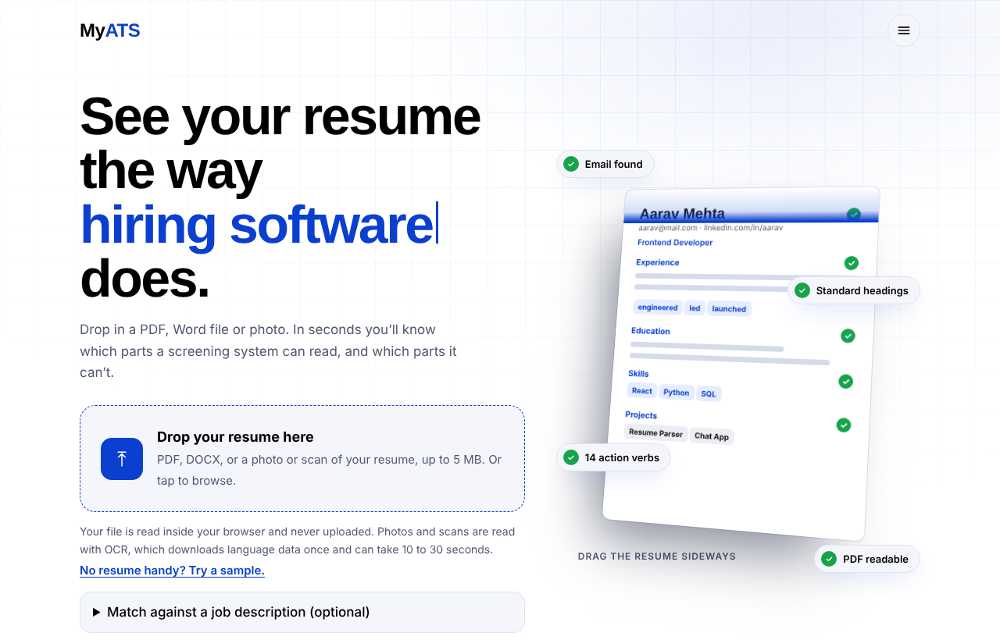
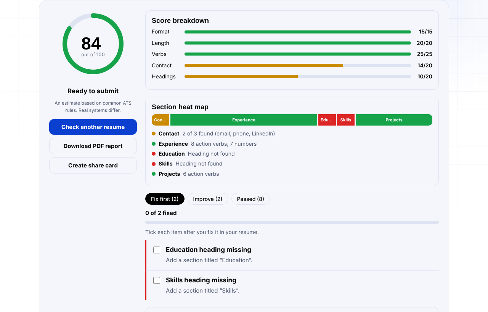
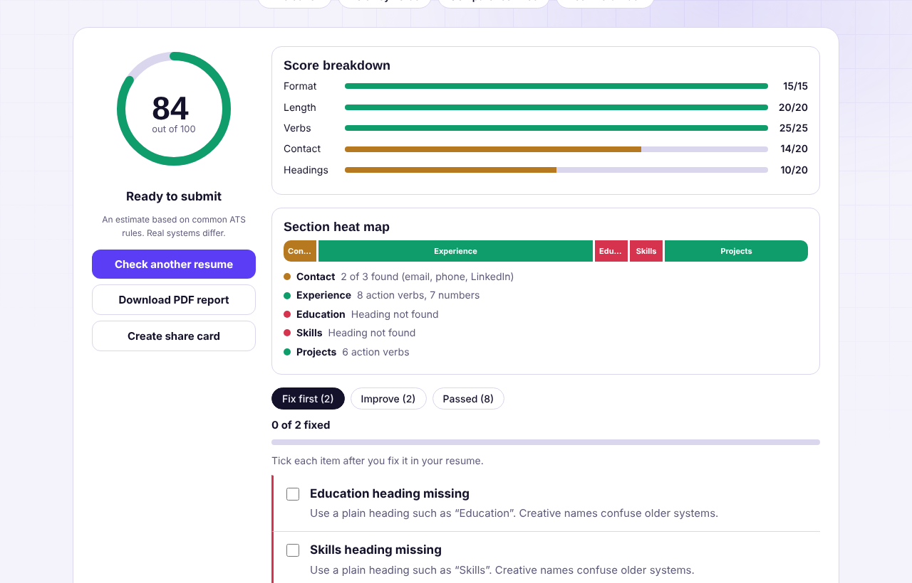
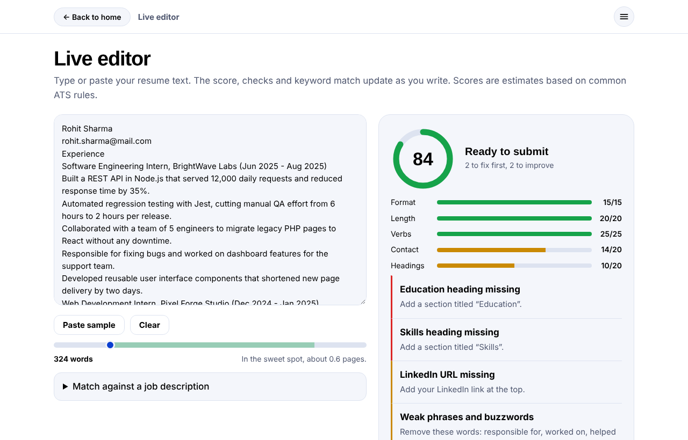
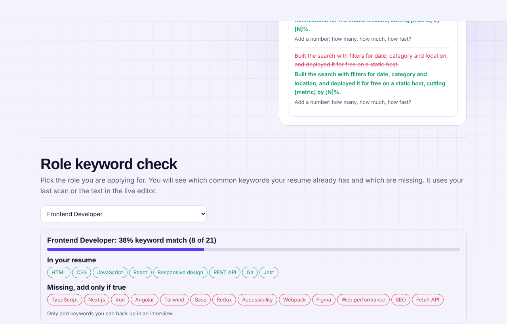
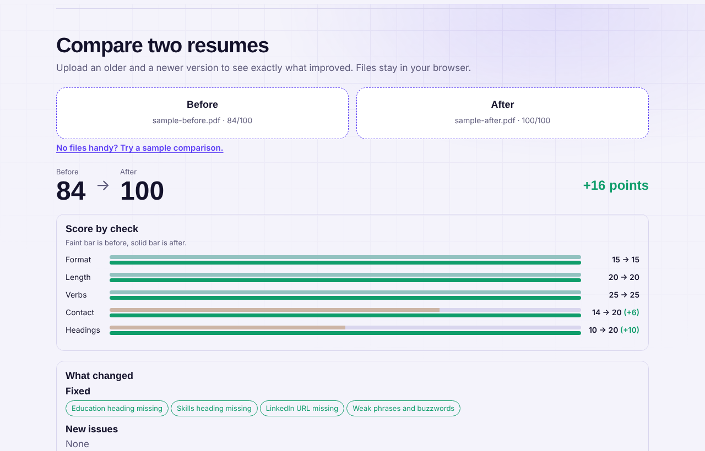
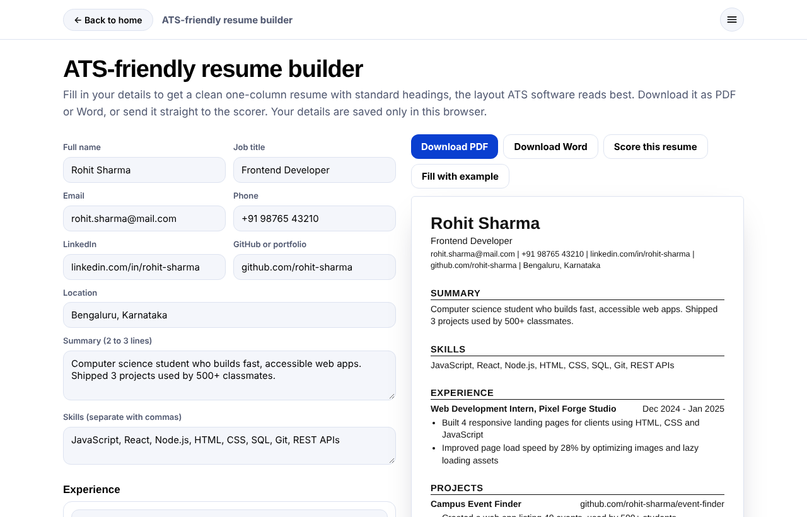
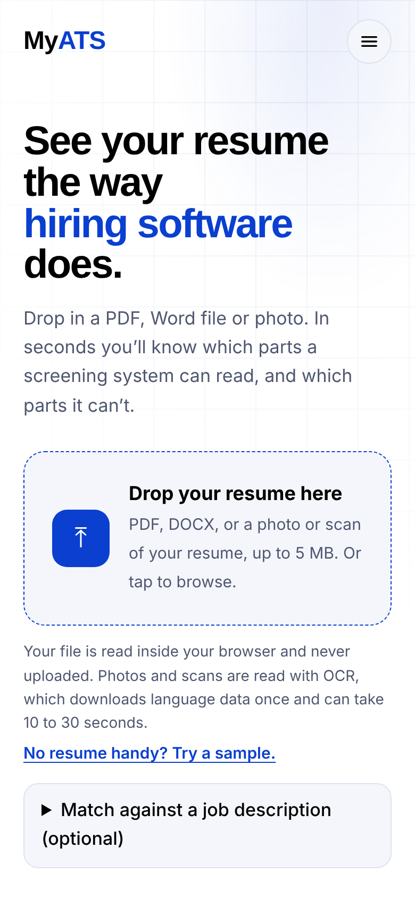

# MyATS: Free Resume ATS Checker

[](https://github.com/veereshr4446/myats/actions/workflows/test.yml)


See your resume the way hiring software does. Drop in a PDF, DOCX or a photo and get a score out of 100, a list of fixes and rewrite tips. **Everything runs in the browser. Nothing is uploaded, and there is no server to pay for.**

**Live demo:** https://veereshr4446.github.io/myats/



## Features

**Check a resume**
- Reads PDF and DOCX in the browser (pdf.js, mammoth.js)
- Reads photos and scanned PDFs with OCR (Tesseract.js, loaded only when needed)
- Score out of 100 with a per-check breakdown, section heat map and fix checklist
- Bullet rewrite tips, for example "Responsible for fixing bugs" becomes "Fixed bugs, improving [metric] by [N]%"
- "Robot view" that highlights action verbs, numbers and weak phrases in the text the parser read
- Job description keyword matcher
- Comparison with your previous scan, and a side-by-side **compare two resumes** tool

**Improve a resume**
- **Live editor:** type or paste text and the score, word counter and job match update as you write
- **Role keyword packs:** 11 roles, shows which common keywords you have and which are missing
- **ATS-friendly resume builder:** one-column layout with standard headings, download as PDF or Word, send it straight to the scorer
- Branded PDF report and a shareable score card

**Polish**
- Rotating sample resumes, scan animation and floating badges on the home page
- Side menu (top left) opens each tool full screen, so the home page stays clean
- Light theme by default, dark theme on toggle, works on phones
- Installable as an app and opens offline (service worker)
- Share preview card and favicon for WhatsApp and LinkedIn links

| Results | Heat map and rewrite tips |
|---|---|
|  |  |

| Live editor | Role keywords |
|---|---|
|  |  |

| Compare two resumes | Resume builder |
|---|---|
|  |  |



## How the score works

The score is an estimate based on common ATS rules. Real systems differ.

| Check | Points | How it is scored |
|---|---|---|
| File format | 15 | PDF or DOCX gets full points, old `.doc` gets 5, images get 0 |
| Length | 20 | 300 to 1,500 words gets 20, over 1,500 gets 10, under 300 gets 0 |
| Action verbs | 25 | 10 or more strong verbs gets 25, otherwise 2.5 points per verb |
| Contact info | 20 | Email 7, phone 7, LinkedIn 6 |
| Section headings | 20 | 5 each for Experience, Education, Skills and Projects |

Extra checks (measurable results, buzzwords) give advice but do not change the score.

## Privacy

Files are read inside your browser and never uploaded. OCR downloads its language data once, but your resume stays on your device. The optional visitor counter uses [GoatCounter](https://www.goatcounter.com), which sets no cookies and records no personal data.

## Run locally

The service worker needs `http`, so use a tiny local server instead of opening the file directly:

```bash
python3 -m http.server 8000
# then open http://localhost:8000
```

## Tests

The scoring engine has automated tests that run on every push with GitHub Actions. They run the real code from `index.html`, so there is nothing to install:

```bash
npm test
```

## Deploy (free)

Enable GitHub Pages (Settings, Pages, deploy from the `main` branch), or import the repo on Vercel or Netlify. It is a static site, so no build step is needed.

## Project structure

```
index.html            the whole app: HTML, CSS and JavaScript
sw.js                 service worker for offline use
manifest.webmanifest  makes the site installable
favicon.svg, icon-*   icons
og.png                share preview image
tests/                scoring engine tests
docs/                 screenshots used in this README
.github/workflows/    CI that runs the tests
```

## Private visitor counter (optional)

1. Create a free account at [goatcounter.com](https://www.goatcounter.com) and choose a site code.
2. Set `GC_CODE` near the top of the extras section in `index.html`.
3. Your dashboard shows visits and "resume-scanned" events. It is private unless you make it public in GoatCounter settings.

## Roadmap

- Hindi and Kannada interface
- More role keyword packs
- Score history chart

## Author

Built with ♥ by **Viresh R**, II Year CSE A, RYMEC.
